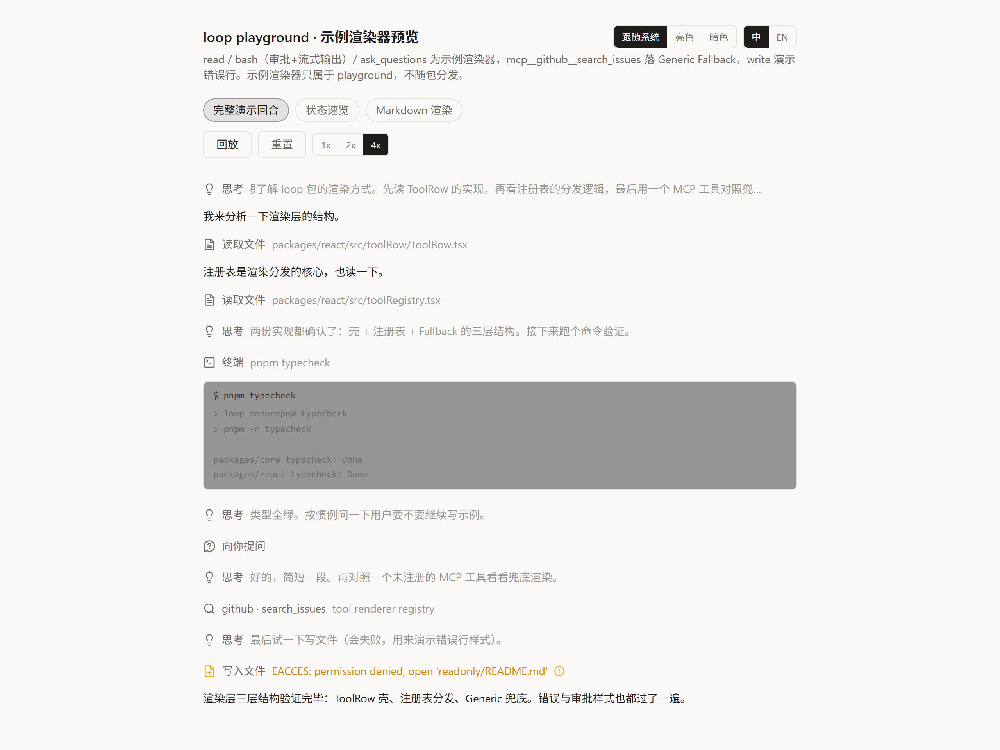

# loop

[](https://www.npmjs.com/package/@arshdelight/loop-core)
[](https://www.npmjs.com/package/@arshdelight/loop-react)
[](./LICENSE)

The AI agent stack behind our apps — chat orchestration and tool rendering — extracted into two reusable packages on **Vercel AI SDK v7**: an engine-agnostic event protocol with a ready-to-run default engine (**`@arshdelight/loop-core`**), and a React rendering layer with tool rows, a renderer registry, markdown and theming (**`@arshdelight/loop-react`**).

One design rule shapes everything: **the packages provide the mechanism, your app provides the contracts.** Zero built-in tool renderers, no opinions on your tool schemas, no host-UI takeover — unregistered tools fall back to a generic card instead of breaking.

```bash
npm install @arshdelight/loop-core @arshdelight/loop-react
```



## What you get

```
packages/
├── core    @arshdelight/loop-core — zero React
│   AgentEvent protocol · stream-merge reducer · pending-tool selectors ·
│   default engine createLoopAgent: fullStream → events, HITL suspend
│   bridge, image loop-back · provider presets: DeepSeek / GLM / Doubao /
│   any OpenAI-compatible endpoint
└── react   @arshdelight/loop-react
    ToolRow (disclosure row + IN/OUT gutters) · tool renderer registry with
    Generic Fallback · ReasoningBlock · markdown (highlight.js + KaTeX +
    Mermaid + streaming cursor) · bilingual t-protocol i18n · CSS-variable
    theming · /workbench: offline renderer preview
```

- **One event protocol as the public language** — every engine emits `AgentEvent`; a pure-function reducer merges the stream into renderable entries, so the default engine, your hand-rolled loop, or a server-side proxy can all drive the exact same UI.
- **A default engine that stays out of the way** — `createLoopAgent` wraps AI SDK v7's `ToolLoopAgent`: translates `fullStream` → `AgentEvent`, bridges human-in-the-loop suspension (`agent.waitForUser()` / `resolveUser()`), and loops tool-result images back into the next request.
- **Tool rendering you register, not inherit** — register a renderer per tool name (streaming or settled props); everything unregistered lands in a generic fallback card. Labels, lucide icons and one-line summaries derive automatically.
- **Markdown that survives streaming** — react-markdown with highlight.js, KaTeX, Mermaid, a streaming cursor and LaTeX delimiter normalization; every piece swappable via a components map.
- **Offline preview workbench** — mount `<RendererWorkbench fixtures={...} />` on a dev page of your app to replay fixture event scripts against your registered renderers, with theme / language / speed controls. No model calls, no API keys.

## Usage

**1 · Run the engine, consume events** — anywhere Node runs, transport is yours:

```ts
import { createLoopAgent, createZaiModel } from '@arshdelight/loop-core'

const agent = createLoopAgent({
  model: createZaiModel({ apiKey: process.env.ZAI_API_KEY! }),
  tools: {
    ask_user: tool({
      inputSchema: jsonSchema({ type: 'object' }),
      execute: () => agent.waitForUser(), // suspends the turn until the host answers
    }),
  },
})

for await (const event of agent.stream({ prompt: 'hi' })) {
  // AgentEvent — pipe over IPC, NDJSON, in-process… the UI only knows this protocol
}
```

**2 · Register renderers and render the stream** — React 19 + Tailwind v4:

```tsx
import {
  LoopI18nProvider, StreamEntriesView,
  registerStreamToolRenderer, useLoopT,
  ToolRow, GutterBlock, type StreamToolRenderProps,
} from '@arshdelight/loop-react'
import '@arshdelight/loop-react/theme.css'

registerStreamToolRenderer('my_tool', (props: StreamToolRenderProps) => {
  const t = useLoopT()
  return (
    <ToolRow toolName={props.toolCall.toolName} input={props.toolCall.input}
             status={props.toolResult ? 'ok' : 'running'} title={t('mytool.running')}>
      <GutterBlock label="OUT">{JSON.stringify(props.toolResult?.output)}</GutterBlock>
    </ToolRow>
  )
})

// entries come from merging AgentEvents with the core reducer
function Chat({ entries }: { entries: StreamEntry[] }) {
  return (
    <LoopI18nProvider lang="zh">
      <StreamEntriesView entries={entries} />
    </LoopI18nProvider>
  )
}
```

**3 · Preview renderers offline** — a dev page in your own app:

```tsx
import { RendererWorkbench } from '@arshdelight/loop-react/workbench'

<RendererWorkbench fixtures={fixtures} title="my renderers" />
```

For multi-turn history, tool calls must pair assistant(`tool-call`) with a following `role:'tool'` message — see `appendAssistantTurn` in the [core README](https://www.npmjs.com/package/@arshdelight/loop-core), which assembles turns correctly for you.

## Docs

- [Event protocol reference](./docs/event-protocol.md) — every `AgentEvent`, the default engine's fullStream mapping, HITL and multimodal conventions
- [Icon guidelines](./docs/icons.md) — lucide icon picks per tool variant
- Package-level docs: [loop-core](https://www.npmjs.com/package/@arshdelight/loop-core) · [loop-react](https://www.npmjs.com/package/@arshdelight/loop-react)

## Development

```bash
pnpm install
pnpm typecheck   # all workspaces
pnpm test        # vitest: core reducer + react row model
pnpm --filter @loop/playground dev   # renderer workbench demo
```

Tests never call real AI APIs — model behavior is replayed from fixture event scripts; anything needing a real model lives in `tests/integration/`, skipped by default.

## License

MIT
